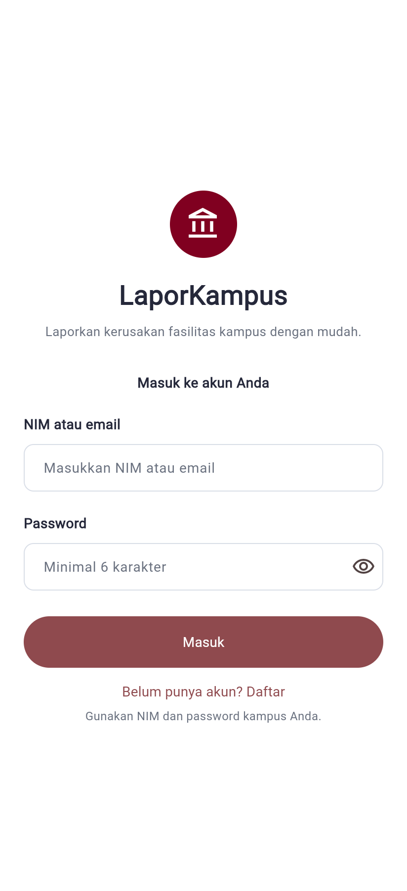
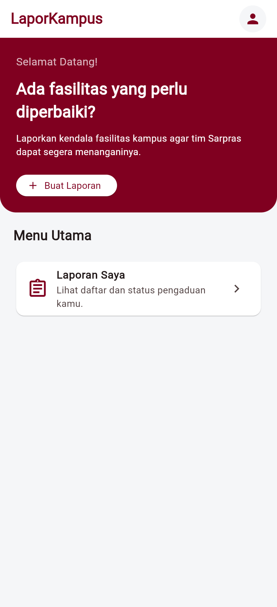
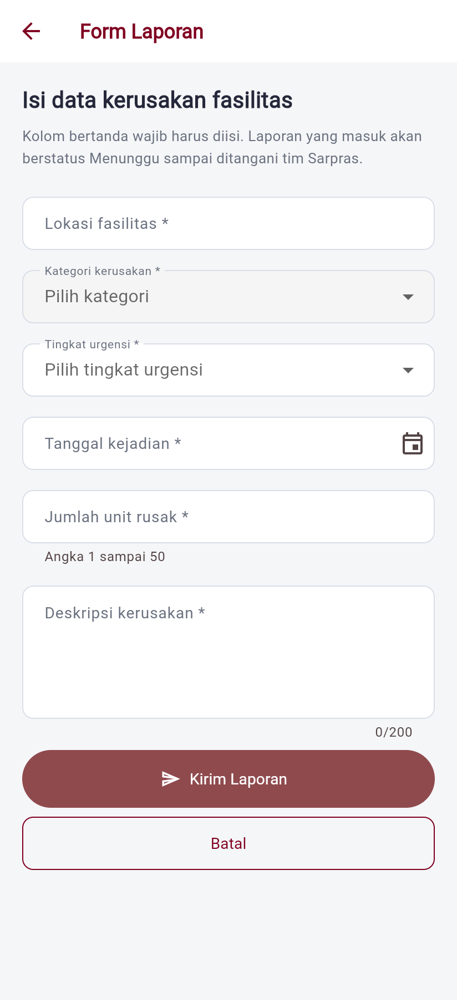
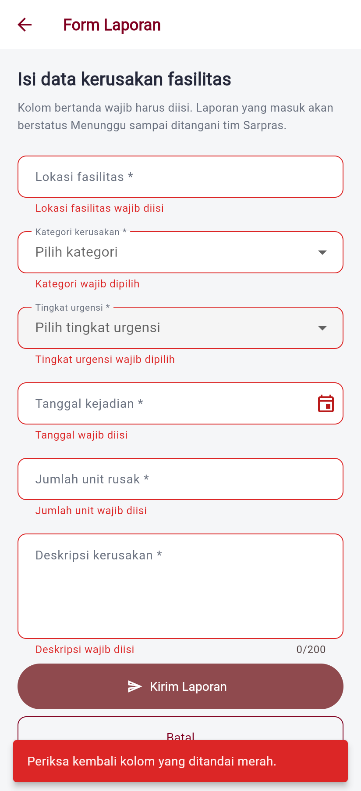
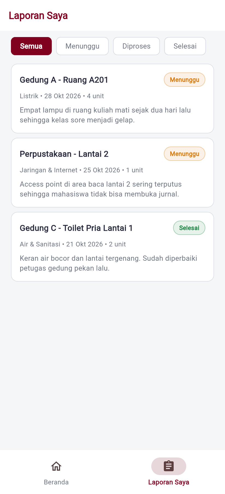
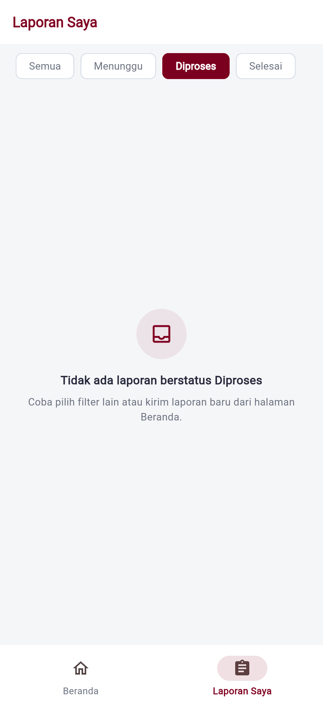
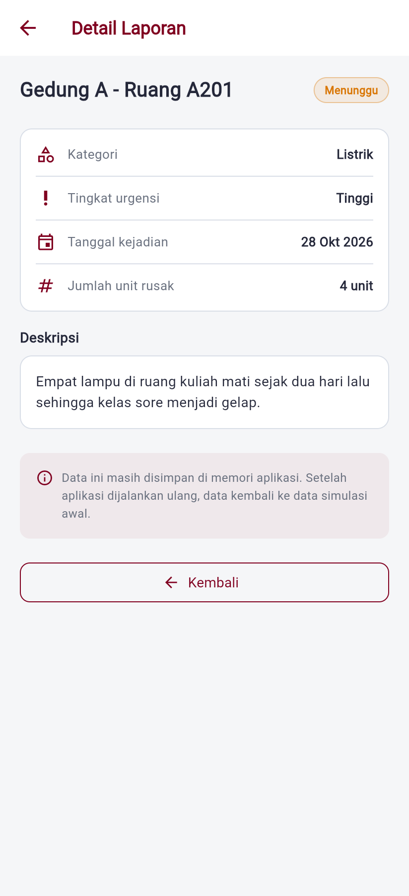

# LaporKampus

Aplikasi pelaporan kerusakan fasilitas kampus. Mahasiswa dapat mencatat laporan  
fasilitas yang rusak dan memantau status penanganannya, sehingga pengaduan tidak  
lagi tercecer di grup chat atau disampaikan secara lisan.

Proyek individu MK Mobile and Web Application Development, Semester Ganjil 2026/2027.

## Identitas

- **Nama:** Wahyu Hari Santosa
- **NIM:** 23.01.55.0003
- **Kelas:** A1 / A2DLC
- **Nama project Flutter:** `laporkampus`

## Tautan

- **Desain Figma (Minggu 4):**  
  <https://www.figma.com/make/RiyY93QWEjZXQP93Cx6Sui/Untitled?code-node-id=0-6\&p=f\&t=EnpQyA2fcK40nQhe-0\&fullscreen=1>
- **Repository GitHub:** <https://github.com/wahyuharis03/laporkampus>
- **Video presentasi UTS:** <https://github.com/wahyuharis03/laporkampus/releases/download/video-uts-final/laporkampus-uts.mp4>
- **Proposal ringkas (PDF):** [`docs/Proposal-UTS-LaporKampus.pdf`](docs/Proposal-UTS-LaporKampus.pdf)

## Video presentasi UTS

Video 7 menit 15 detik yang mengikuti alur brief UTS: pembuka, masalah dan
pengguna, kebutuhan dan prioritas, rancangan (user flow, sitemap, wireframe),
demo aplikasi yang berjalan di Chrome, lalu rencana teknis dan penutup.
Narasi Bahasa Indonesia dibuat dengan edge-tts; gambar disusun dengan Remotion.

Demo pada video adalah rekaman layar aplikasi sungguhan di Chrome, bukan slide:
login dengan validasi kolom kosong, Beranda dan detail laporan, formulir enam
kolom yang menolak isian kosong, pengisian yang benar (Gedung D5-04, Lainnya,
Rendah, 1 unit), SnackBar hijau saat terkirim, lalu daftar laporan dengan filter
status.

- **Tonton atau unduh:**  
  <https://github.com/wahyuharis03/laporkampus/releases/download/video-uts-final/laporkampus-uts.mp4>
- **Demo saja (2:24, bernarasi):**  
  <https://github.com/wahyuharis03/laporkampus/releases/download/video-uts-final/laporkampus-demo.mp4>
- **Kode sumber video:** [`video-uts/`](video-uts/) — naskah, skrip TTS, skrip
  pemotong rekaman demo, dan komponen tiap adegan
- **Catatan revisi naskah:** [`video-uts/CATATAN-REVISI.md`](video-uts/CATATAN-REVISI.md)

## Proposal ringkas

[`docs/Proposal-UTS-LaporKampus.pdf`](docs/Proposal-UTS-LaporKampus.pdf) memuat
identitas, problem statement, persona, lima user story, kebutuhan fungsional dan
prioritasnya, user flow, sitemap, wireframe beserta tautan Figma, tech stack, dan
rancangan collection Firestore. Sumbernya ada di
[`docs/proposal-uts.html`](docs/proposal-uts.html).

## Tangkapan layar

| Halaman Login | Halaman Beranda |
| ------------- | --------------- |
|  |  |

| Form Laporan | Form Laporan — validasi |
| ------------ | ----------------------- |
|  |  |

| Laporan Saya | Keadaan kosong |
| ------------ | -------------- |
|  |  |

| Detail Laporan |
| -------------- |
|  |

Semua tangkapan layar diambil dari aplikasi yang berjalan di Chrome dengan data
simulasi. Tidak ada data pribadi di dalamnya.

## Halaman dan navigasi

| Kode | Halaman        | Prioritas | Keterangan                                                     |
| ---- | -------------- | --------- | -------------------------------------------------------------- |
| H1   | Login          | Must      | NIM atau email, dua mode Masuk/Daftar, di luar menu navigasi   |
| H2   | Beranda        | Must      | Sapaan, ringkasan status, tombol aksi utama, laporan terbaru   |
| H3   | Form Laporan   | Must      | Form 6 kolom dengan validasi, dibuka lewat `Navigator.push`    |
| H4   | Laporan Saya   | Must      | Daftar laporan + filter status, keadaan kosong                 |
| H5   | Detail Laporan | Should    | Rincian satu laporan, dibuka dari Beranda atau Laporan Saya    |

Navigasi utama memakai `NavigationBar` di ponsel dan berubah menjadi  
`NavigationRail` pada lebar layar ≥ 600 px. Menu yang sama dipakai di kedua  
ukuran: **Beranda** dan **Laporan Saya**.

## Aturan validasi form

| Kolom               | Widget                             | Aturan                                | Pesan kesalahan                                            |
| ------------------- | ---------------------------------- | ------------------------------------- | ---------------------------------------------------------- |
| Lokasi fasilitas    | `TextFormField`                    | Wajib; minimal 5 karakter             | Lokasi fasilitas wajib diisi / Lokasi minimal 5 karakter   |
| Kategori kerusakan  | `DropdownButtonFormField`          | Wajib dipilih                         | Kategori wajib dipilih                                     |
| Tingkat urgensi     | `DropdownButtonFormField`          | Wajib dipilih                         | Tingkat urgensi wajib dipilih                              |
| Tanggal kejadian    | `TextFormField` + `showDatePicker` | Wajib; 30 hari terakhir s.d. hari ini | Tanggal wajib diisi                                        |
| Jumlah unit rusak   | `TextFormField` angka              | Wajib; angka; > 0; ≤ 50               | Jumlah unit tidak boleh nol / Maksimal 50 unit per laporan |
| Deskripsi kerusakan | `TextFormField` multiline          | Wajib; minimal 15 karakter            | Deskripsi minimal 15 karakter                              |

Hasil kirim ditampilkan lewat `SnackBar`: merah bila masih ada kolom yang salah,  
hijau bila laporan berhasil disimpan.

## Struktur project

```
lib/
  main.dart                     # init Firebase, tema, halaman pertama
  firebase_options.dart         # konfigurasi project Firebase
  data/
    data_laporan.dart           # model Laporan, data simulasi, helper format
  layanan/
    auth_layanan.dart           # pembungkus Firebase Auth, aturan NIM jadi email
    pesan_galat.dart            # kode kesalahan Firebase jadi kalimat pengguna
  pages/
    cek_status_login.dart       # gerbang status login (StreamBuilder)
    login_page.dart             # H1 Login, dua mode: Masuk dan Daftar
    halaman_konfigurasi.dart    # petunjuk bila Firebase belum disiapkan
    halaman_utama.dart          # NavigationBar / NavigationRail
    beranda_page.dart           # H2 Beranda
    form_laporan_page.dart      # H3 Form Laporan
    laporan_saya_page.dart      # H4 Laporan Saya
    detail_laporan_page.dart    # H5 Detail Laporan
  theme/
    app_theme.dart              # palet, jarak, dan tema Material 3
  widgets/
    keadaan_kosong.dart         # komponen keadaan kosong yang dipakai ulang
    label_status.dart           # chip status Menunggu / Diproses / Selesai
test/
  widget_test.dart              # 18 test: aturan akun, login, beranda, form
docs/                           # screenshot untuk README
```

## Cara menjalankan

Prasyarat: Flutter SDK 3.x, Chrome, Git, dan Node.js (untuk Firebase CLI).

```bash
# 1. Ambil kode
git clone https://github.com/wahyuharis03/laporkampus.git
cd laporkampus

# 2. Pasang dependensi
flutter pub get

# 3. Hubungkan ke project Firebase Anda
dart pub global activate flutterfire_cli
firebase login
flutterfire configure --platforms=web

# 4. Jalankan di Chrome
flutter run -d chrome
```

Sebelum langkah 3, siapkan project Firebase lebih dulu di
`console.firebase.google.com`:

1. Buat project baru, tetap di paket **Spark** (tanpa billing account).
   Gemini dan Google Analytics boleh dimatikan.
2. Buka **Security > Authentication > Sign-in method**, aktifkan
   **Email/Password**. Tanpa langkah ini login gagal dengan
   `operation-not-allowed`.
3. Buka **Project settings**, klik ikon `</>` untuk mendaftarkan aplikasi web.

`flutterfire configure` menimpa `lib/firebase_options.dart` dengan nilai dari
project Anda. Bila CLI gagal terpasang, salin objek `firebaseConfig` dari
Project settings lalu ganti setiap nilai bertanda `GANTI` di file itu.
Isi file tersebut adalah pengenal project, bukan password, sehingga aman
di-commit.

Bila langkah 3 terlewat, aplikasi tidak menampilkan layar putih: ia berhenti
di halaman petunjuk berisi langkah perbaikan.

Perintah pendukung:

```bash
flutter analyze   # memeriksa masalah kode
flutter test      # menjalankan 18 test tanpa menghubungi Firebase
```

## Catatan tentang autentikasi

Login memakai Firebase Authentication dengan penyedia Email/Password. Karena
Firebase mewajibkan email sedangkan aplikasi memakai NIM, `auth_layanan.dart`
mengubah NIM menjadi `<nim>@laporkampus.app`. Kolom login tetap menerima
keduanya: bila pengguna mengetik email, dipakai apa adanya.

Sesi dikelola Firebase, jadi tetap bertahan setelah halaman di-refresh.
Perpindahan halaman tidak memakai `Navigator`: `CekStatusLogin` mendengarkan
`authStateChanges()` dan memilih halaman yang sesuai. Inilah sebabnya setelah
login berhasil halaman berganti sendiri, dan setelah menekan Keluar pengguna
kembali ke halaman masuk.

Pesan kesalahan sengaja tidak membocorkan apakah sebuah email terdaftar.
Kode `invalid-credential`, `wrong-password`, dan `user-not-found` semuanya
ditampilkan sebagai "Email atau password salah".

## Catatan tentang data

Data laporan masih disimpan di `List<Laporan>` di memori (`lib/data/data_laporan.dart`).  
Laporan yang dikirim akan tampil di Beranda dan Laporan Saya selama aplikasi  
berjalan, lalu kembali ke data simulasi awal setelah aplikasi dimuat ulang.  
Sesi login bertahan, tetapi laporan belum: pemindahan data ke Cloud Firestore
dilakukan pada Minggu 10.

## Gaya visual

Mengikuti style guide mini Minggu 4. Palet sengaja dibatasi lima warna:

- Primer maroon `#800020`
- Latar `#F5F6F8`, teks utama `#25283A`, teks sekunder `#6B7280`, garis `#D9DEE7`
- Status: menunggu `#D97706`, selesai `#15803D`, galat `#DC2626`
- Jarak kelipatan 8 (8 / 16 / 24), radius 10–12, tombol utama tinggi 52

## Batasan project

- Flutter + Dart, Firebase paket Spark (tanpa billing account)
- Autentikasi email/password, bukan OTP telepon
- Tanpa Cloud Functions dan payment gateway. Paket dari pub.dev dibatasi pada
  `firebase_core` dan `firebase_auth`
- Satu peran pengguna: mahasiswa

## Riwayat pertemuan

| Minggu | Luaran                                                               |
| ------ | -------------------------------------------------------------------- |
| 1      | Ide aplikasi, kanvas, problem statement                              |
| 2      | Persona, user story, kebutuhan berprioritas, use case inti           |
| 3      | User flow, sitemap, prioritas halaman, rancangan navigasi            |
| 4      | Wireframe dan style guide mini di Figma                              |
| 5      | Project Flutter berjalan, repository GitHub, README                  |
| 6      | Lima halaman terhubung, NavigationBar, data simulasi, keadaan kosong |
| 7      | Form Laporan dengan validasi, SnackBar status, dan state sederhana   |
| 8      | UTS: proposal, video presentasi, repository                          |
| 9      | Firebase Authentication: daftar, masuk, keluar, gerbang status login |
